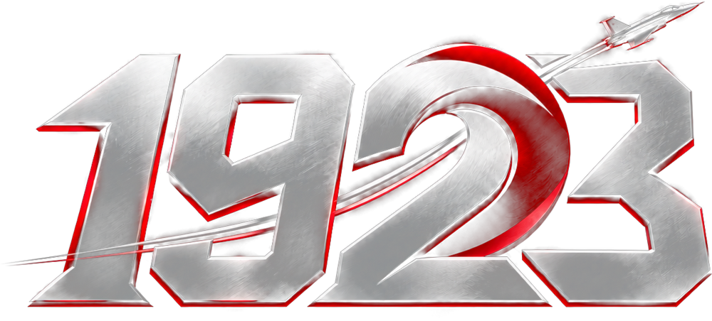
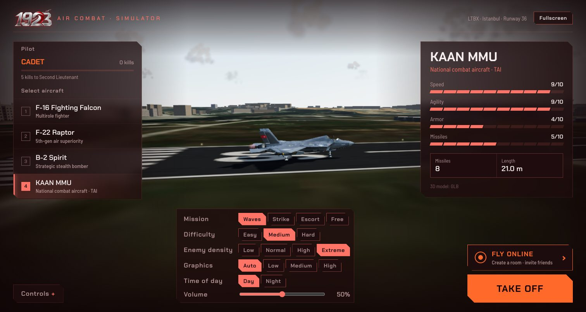
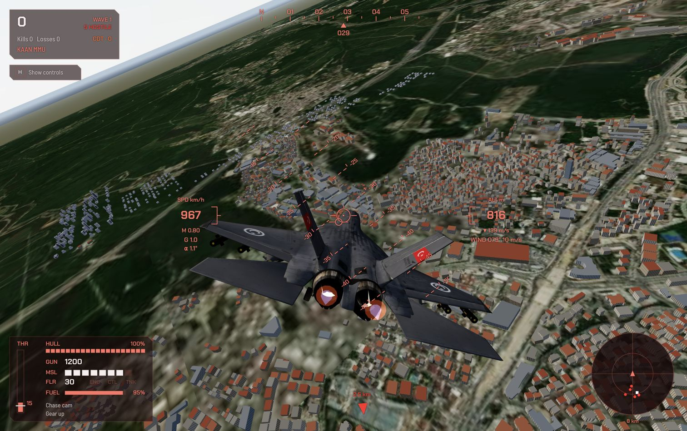
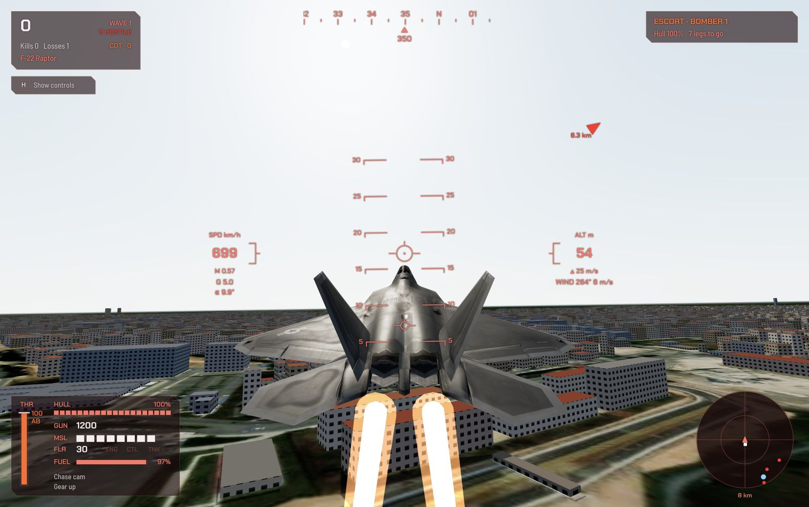
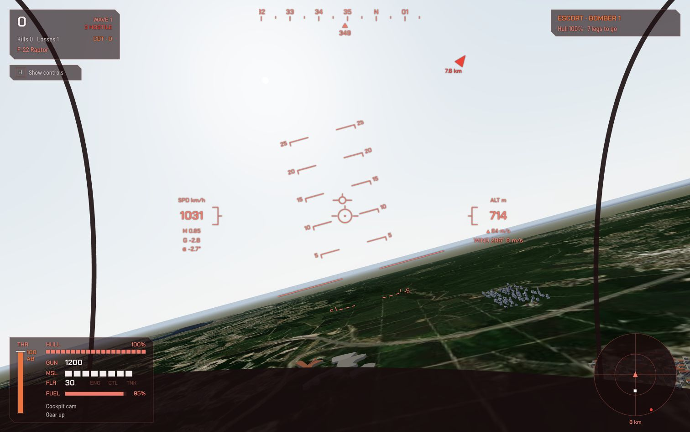

<div align="center">



# 1923 Air Combat

**English** | [Türkçe](README.tr.md)

**Browser-based flight and combat simulator over the skies of Istanbul**

Take off from the Turkish Air Base (LTBX), shoot down enemy waves, and land back on the runway in one piece.

[](https://1923-air-combat.enesbuyuk.com)

[](LICENSE)


[](https://github.com/enesbuyuk/1923-air-combat)

**[Play in your browser →](https://1923-air-combat.enesbuyuk.com)** · [Report a bug](https://github.com/enesbuyuk/1923-air-combat/issues) · [Request a feature](https://github.com/enesbuyuk/1923-air-combat/issues)

</div>

---

## Table of Contents

- [Screenshots](#screenshots)
- [Features](#features)
- [Simulator review and next steps (Turkish)](docs/simulator-review.tr.md)
- [Aircraft](#aircraft)
- [Quick Start](#quick-start)
- [Controls](#controls)
- [Game Modes](#game-modes)
- [Survival Tips](#survival-tips)
- [Landing Guide](#landing-guide)
- [3D Models](#3d-models)
- [City](#city)
- [Project Structure](#project-structure)
- [Credits and Licenses](#credits-and-licenses)
- [License](#license)

## Screenshots

Captured from the game running locally. Click an image to view it at full size.

| Aircraft selection | KAAN over Istanbul |
|:---:|:---:|
| [](docs/screenshots/aircraft-selection.jpg) | [](docs/screenshots/kaan-flight.jpg) |

| F-22 climb in Escort mode | Cockpit view and flight HUD |
|:---:|:---:|
| [](docs/screenshots/f22-takeoff.jpg) | [](docs/screenshots/cockpit-hud.jpg) |

## Features

- **Rust → WebAssembly game core:** flight physics, takeoff/landing, stall, bot AI, cannon rounds, guided missiles with lock-on, flares, collisions, wave system and missions. No external dependencies, ~130 KB.
- **Flight physics:** a real velocity vector with angle of attack and sideslip; lift and drag scale with ISA air density and airspeed², so turns are limited by speed (corner speed) and a per-aircraft G limit, and hard pulls bleed energy through induced drag. Transonic drag rise near Mach 1, thrust that thins with altitude, engine spool lag, ground effect, and wind with gusts and low-level turbulence (crosswind crabbing on approach, weathervaning on the runway).
- **Six-degree-of-freedom rigid body:** aerodynamic moments (static stability, pitch / roll / yaw damping, dihedral, control surfaces, stall break, wing drop and autorotation) and gyroscopic inertia coupling (Euler's equations) turn the airframe. A fly-by-wire flight control computer with AoA / G limiter, auto-trim, turn coordination and rolls about the flight path drives rate-limited control surfaces by dynamic inversion of the unstalled airframe, so a slow or stalled aircraft runs out of authority on its own. Everything advances with a fourth-order Runge-Kutta integrator at 120 Hz.
- **Fuel and weight:** fuel flow rises steeply in afterburner; a full tank is heavier (higher stall speed, slower climb) and a dry tank flames the engine out.
- **Energy and limits:** controls stiffen at high speed, so an aircraft turns and rolls best near corner speed, not at top speed; rolling while pulling hard is slower. Holding the stick back in a ruddered stall autorotates into a spin (stick forward and opposite rudder to recover), and diving past the structural speed limit damages the airframe (OVERSPEED).
- **Real performance envelope:** thrust-to-weight close to the real aircraft (F-16 ~1.1, B-2 ~0.4), thrust lapse with altitude that steepens above the tropopause (so each aircraft has a service ceiling), afterburner thrust that grows with Mach, and fuel flow that jumps when the afterburner is lit. Cannon rounds slow down with drag and spread; missiles burn for five seconds, fuse at the closest pass and do less damage the further they miss; modern seekers reject most flares; aircraft that touch in the air are both lost.
- **Simulator only:** every mission uses the same fixed rules: no cannon aim assist or extra hitbox enlargement; aircraft-specific ammunition (F-16: 511 rounds; player and bot B-2s carry no cannon or air-to-air missiles); strict landing limits (6 m/s sink, about 20° bank and a tyre ground-speed limit); manual return at the mission boundary (30 s before the aircraft is lost); and 90 s ground servicing. Enemy and player missiles use the same warhead damage. There is no realism toggle.
- **Manual landing gear and flaps:** `G` commands the gear; `Z` cycles clean / takeoff / landing flaps. Actuators take time, gear adds drag, flaps add lift and drag and lower the stall speed. Excess airspeed can damage and jam them. Gear-up, incomplete or badly damaged gear cannot make a normal wheel landing.
- **Terrain and surfaces:** the renderer and physics query the same deterministic height field. The airfield stays level; hills affect AGL, ground effect, ground contacts and sensor masking. Asphalt and soil have different rolling resistance and braking; water contact is fatal. Terrain and coastline are representative procedural data, not a surveyed Istanbul DEM.
- **Sensors:** radar and visual acquisition use range, scan cone and line of sight through terrain and the rendered building footprints. Contacts refresh four times per second; a lost contact remains at its last known position for 1.5 s, marked MEM, then expires. Hidden aircraft do not broadcast live positions to the HUD.
- **System damage:** hits can knock out the engine (less thrust), the flight controls (sluggish pitch and roll) or hole the fuel tank (leak), on top of hull damage.
- **Ground crew:** taxi into one of the five hangars on the airfield and stop with the throttle at idle; the crew rearms, refuels and repairs the aircraft in 90 seconds. Nowhere else.
- **Enemies fly the same flight model:** bot AI only moves the stick and throttle, so enemies bleed energy in turns, can stall and must avoid the ground. Player and AI use the same fuel consumption, weapon capacities, gun cadence, dispersion, projectile speed, warhead damage, damage probabilities and overspeed limits. Difficulty changes pilot behaviour (decisions, aim, lock time, missile range and cadence) and the wave size, not hull health or weapon damage. Bots return when low on fuel or out of weapons and operate their gear/flaps for the approach; a safe touchdown retires the sortie. Tactics include patrol, pursuit, defensive turns, missile evasion and low-altitude recovery.
- **Missiles with real energy:** proportional navigation guidance, a rocket motor that burns for a few seconds and then coasts, drag that grows with air density, fins that lose authority when slow, and a seeker gimbal limit. A late, slow missile can be out-turned; a distant fleeing target cannot be run down.
- **Countermeasures and warning:** fighters carry their aircraft’s missile load from the first wave. Air-to-air infrared seekers are passive and do not trigger the RWR; radar-guided SAM locks do. The missile warning system needs line of sight and detects threats within 8 km. Flares can seduce IR missiles, while radar-guided SAMs must be evaded or masked by terrain/buildings.
- **Missions:** endless *Waves*, *Strike* (destroy the SAM sites of each target area; they fire at anything above their radar horizon, so fly low) *Escort* (protect a friendly B-2 around its route) and *Free* (no enemies, just fly).
- **Kill cam:** after being shot down, the last seconds replay in slow motion.
- **Day and night:** the *Time of day* setting (menu or pause screen) switches to a moonlit night with stars, a dark haze, lit windows across the city and glowing runway edge lights; every aircraft shows red/green position lights, white tail light, double-flashing strobes and a red beacon, and with the gear down a landing light that lights the runway ahead of the player. Afterburners and explosions stand out. It can be changed mid-flight.
- **Fixed-step simulation:** the core always advances 1/60 s per step regardless of frame rate, and rendering interpolates between steps.
- **Gamepad and touch:** standard-mapping gamepads work out of the box; touch screens get an on-screen stick, throttle and buttons.
- **Real world:** Esri World Imagery satellite tiles (3 zoom levels); runways, aprons and helipads from OpenStreetMap geometry (18/36 main runway 1415 m, 04/22 crosswind runway).
- **Endless procedural city:** unfolds around you as you fly, a different Istanbul skyline every game.
- **Lock-on missiles and unassisted cannon fire**
- **Pilot career:** every kill adds to a career total saved in the browser; it promotes you from Cadet (0) through Second Lieutenant (5), First Lieutenant (15), Captain (30), Major (60), Lieutenant Colonel (100), Colonel (175), Brigadier General (275), Major General (400) and Lieutenant General (600) to General (900).
- **Synthesized audio:** engine, weapons and explosions are generated live with WebAudio. The only recorded sound is the "Pull up, pull up" ground-proximity voice warning (`web/audio/pull_up.mp3`).
- **No installation:** runs in the browser.

## Aircraft

| Aircraft | Character |
|---|---|
| **F-16 Fighting Falcon** | Balanced, agile |
| **F-22 Raptor** | Fastest and most agile |
| **B-2 Spirit** | Strategic bomber; no cannon or air-to-air missiles (bombing is not yet implemented) |
| **KAAN MMU** | Fast, agile, 8 missiles |

Enemies are red-tinted versions of the same models. From wave 3 onward, every wave includes one **B-2** (500 points).

## Quick Start

No setup needed to play: open **[1923-air-combat.enesbuyuk.com](https://1923-air-combat.enesbuyuk.com)**.

To run it locally:

**Requirements:** [Rust](https://rustup.rs) (`rustup`), Python 3

```bash
git clone https://github.com/enesbuyuk/1923-air-combat.git
cd 1923-air-combat
./build.sh serve        # builds the wasm, opens http://localhost:8080
```

- Build only: `./build.sh`
- If 8080 is taken, the script finds the next free port; to pick one manually: `PORT=3000 ./build.sh serve`
- If [Binaryen](https://github.com/WebAssembly/binaryen)'s `wasm-opt` is installed, the build runs it on the wasm (`-O3`; `WASM_OPT=-Oz ./build.sh` for size, `WASM_OPT=0` to skip)
- Optional model compression: `tools/optimize_models.sh` writes KTX2 (or webp) textures and Meshopt geometry to `dist/models/` without touching `web/models/`; see the script header for options

> [!NOTE]
> The WASM is loaded via `fetch`, so opening `index.html` over `file://` won't work; an HTTP server is required.

## Controls

| Key | Action |
|---|---|
| `S` / `↓` | Nose up (press at Vr during takeoff) |
| `W` / `↑` | Nose down |
| `A` `D` / `←` `→` | Roll |
| `Q` `E` | Rudder (nose wheel on the ground) |
| `Shift` / `R` | Throttle up |
| Left `Ctrl` / `F` | Throttle down (in fullscreen, `Ctrl+W` won't close the tab) |
| `Space` / left click | Cannon along the bore axis, with dispersion and ballistic drop; no aim assist |
| `X` / right click | Missile, keep the target inside a 30° cone for ~0.6 s to lock on |
| `C` | Flares (hold to keep dropping) |
| `B` | Wheel brake on the ground, airbrake in the air |
| `G` | Command landing gear up / down (retraction inhibited on the ground) |
| `Z` | Cycle flaps: up / takeoff (50%) / landing (100%) |
| `V` | Camera (cockpit / chase) |
| `H` | Show / hide controls list |
| Mouse wheel | Chase camera zoom |
| Middle mouse drag | Look around (cockpit) / orbit (chase) |
| `I` | Invert pitch axis |
| `M` | Toggle sound |
| `N` | Toggle warning sounds (RWR, launch, pull up) |
| `Esc` | Pause |

**Gamepad** (standard mapping): left stick pitch and roll, right stick rudder, `RT` / `LT` throttle up / down, `A` cannon, `B` missile, `X` or `RB` flares, `LB` brake, D-pad up gear, D-pad down flaps, `Y` camera, `Start` pause.

**Touch screens:** an on-screen stick (bottom left), a throttle slider and weapon buttons (bottom right) appear while flying.

## Game Modes

Pick the mission in the menu or the pause screen. All missions use simulator flight rules.

| Mode | Goal |
|---|---|
| **Waves** | Endless enemy waves with aircraft-specific fuel and weapon loads. Later waves increase numbers and pilot skill. |
| **Strike** | Destroy every SAM site of the target area with cannon or missiles (they lock like aircraft). Each site acquires an aircraft above ~120 m AGL within 7 km when its line of sight is clear; terrain and buildings can mask you. A cleared area pays a bonus and the next, larger one appears. Smaller enemy waves fly cover. |
| **Escort** | A friendly B-2 (blue on the HUD and radar) flies a circuit around the base. Enemy fighters go for it; bring it around eight legs for the bonus. |
| **Free** | No enemies, no SAM sites, no objectives. Just fly around the city. |

## Survival Tips

- The radar ring and a rising chirp mean an enemy radar is locking you; a fast warble and a red spoke on the radar mean a missile is in the air.
- Against a missile: drop flares (`C`), pull the throttle back and turn hard across its path. Missiles lose energy after the motor burns out, so a late, slow missile can be out-turned.
- Watch the fuel gauge: `BINGO FUEL` means head home. Land, taxi into a hangar, stop with `B` and idle; the ground crew restores fuel, weapons, flares, hull and systems.

## Landing Guide

1. Cut throttle with `Ctrl`, open the airbrake with `B`.
2. Slow to ~300-350 km/h and set up a shallow (~3°) glide; the nose sits ~10° above the flight path marker (that is the angle of attack). The engine needs a few seconds to spool, so add power early.
3. In the last 25 m, ground effect softens the descent; raise the nose slightly with `S` (flare). In a crosswind the aircraft crabs into the wind; the wheels straighten it on touchdown.
4. Lower the gear with `G` below 155 m/s equivalent airspeed; allow 3 seconds for full deployment. Cycle flaps with `Z`, extending landing flaps below 105 m/s equivalent airspeed; allow 2 seconds for full travel. Verify gear DOWN and healthy before touchdown. Retract gear and flaps after establishing a positive climb on takeoff. With idle throttle on the runway, lift dumpers keep the aircraft down.

| Touchdown limit | Value |
|---|---|
| Sink rate | < 6 m/s; above 3 m/s damages the airframe and can destroy an already damaged aircraft |
| Bank | < ~20° (the combined pitch and bank affect the limit) |
| Nose | < ~20° down |
| Ground speed | < 2 × the nominal 1 G stall speed (F-16: 110 m/s, 396 km/h) |

Harder landings or steep dives end in an explosion. Buildings under the approach paths of both runways are kept below a 1:40 obstacle surface, so a normal glide clears them.

## 3D Models

GLB models for all four aircraft live under `web/models/`. If a file is missing, the game generates its own procedural model for that aircraft. To replace one, drop in a file with the same name:

```
web/models/f16.glb
web/models/f22.glb
web/models/b2.glb
web/models/kaan.glb
```

- If the model has parts named `landingOn`/`landingOff` (or `gearDown`/`gearUp`), the landing gear extends and retracts automatically and the wheels are seated on the runway.
- Scale is automatic: the model is normalized to the aircraft's real length (e.g. F-16 → 15 m). The nose should face `-Z`.
- A model facing the wrong way is fixed via `web/models/models.json`:

```json
{
  "f16": { "rotation": [0, 180, 0], "scale": 1 },
  "kaan": { "rotation": [0, 90, 0], "lengthAxis": "z" }
}
```

Mind the licenses of the models you use (CC-BY requires attribution).

## City

Around the airport (~6 km) there are **real buildings**: building footprints pulled from OpenStreetMap are extruded based on their level/height data (`web/js/buildings.js`, data in `web/data/buildings.json`). To refresh the data or change the radius:

```bash
uv run python3 tools/fetch_osm_buildings.py 6000   # radius in meters
```

Building data © [OpenStreetMap](https://www.openstreetmap.org/copyright) contributors, ODbL.

Beyond that area, a random city continues. Buildings and trees come from Kenney's [City Kit (Commercial)](https://kenney.nl/assets/city-kit-commercial) and [City Kit (Suburban)](https://kenney.nl/assets/city-kit-suburban) packs (CC0), under `web/models/city/`.

`web/js/city.js` splits the world into 500 m chunks. As the player flies, nearby chunks are filled using seeded randomness:

- **Downtown** → offices and skyscrapers
- **Suburbs** → houses
- **Rural** → trees

Nearby chunks are detailed; distant ones are drawn with low-detail models. Every launch gets a new seed → a new city; returning to an area within the same session shows the same buildings.

## Project Structure

```
wasm/src/lib.rs                WASM exports (Rust → wasm32-unknown-unknown)
wasm/src/config.rs             aircraft performance, difficulty, physics and runway constants
wasm/src/layout.rs             output buffer layout shared with JS
wasm/src/math.rs               vectors, quaternions, RNG
wasm/src/entities.rs           shared airframe state, player, bot, bullet, missile, flare, SAM site data
wasm/src/game/aero.rs          flight model shared by the player and the bots (lift, drag, thrust, fuel, mass, 6DOF rigid body, fly-by-wire)
wasm/src/game/flight.rs        player: ground roll, touchdown, ground crew, weapons, flares, lock-on
wasm/src/game/bots.rs          enemy waves, bot tactics and autopilot
wasm/src/game/projectiles.rs   cannon rounds, missile guidance and energy, flares
wasm/src/game/missions.rs      game modes: waves, strike (SAM sites), escort, free
wasm/src/game/                 also game state (mod.rs), atmosphere/weather (air.rs), tests (cargo test)
web/index.html                 menu + overlays
web/js/main.js                 boot, game state, game loop, event handling
web/js/sim.js                  wasm loading + decoding buffers into named fields
web/js/layout.js               JS mirror of layout.rs
web/js/aircraft.js             aircraft roster (name, length, cockpit eye, nozzles, missiles, G limit)
web/js/actors.js               player/bot aircraft in the scene: flames, landing gear
web/js/camera.js               menu, cockpit, chase, wreck and kill-cam cameras
web/js/airflow.js              airflow streaks and buffet level (gusts, turbulence, high alpha)
web/js/vortex.js               wingtip vortex ropes (circulation, sink, roll-up, ground effect, core growth)
web/js/vapor.js                wing vapor over the upper wing in hard pulls, transonic vapor cone
web/js/atmosphere.js           day and night sky, image-based lighting, altitude-dependent haze (aerial perspective)
web/js/clouds.js               cumulus field around the camera, whiteout inside a cloud
web/js/post.js                 post-processing: heat shimmer, cloud whiteout, bloom, tone mapping
web/js/flyby.js                other aircraft heard nearby (Doppler, panning) and sonic booms
web/js/wing.js                 wingtip and root chord measured from each model's mesh
web/js/input.js                keyboard / mouse / gamepad controls
web/js/touch.js                on-screen touch controls
web/js/replay.js               kill-cam recording and slow-motion replay
web/js/ground.js               SAM site models (strike mode)
web/js/gforce.js               G blackout / G-LOC effect
web/js/menu.js                 aircraft selection menu
web/js/settings.js             mission / difficulty / enemy density settings
web/js/collision.js            building collision tests
web/js/models.js               procedural aircraft + GLB loader
web/js/navlights.js            aircraft position lights, strobes, beacon and landing light (night)
web/js/world.js                satellite ground, runways, sky
web/js/buildings.js            real buildings from OSM (around the airport)
web/js/city.js                 streaming procedural city (Kenney models)
web/js/effects.js              tracers, missiles, flares, explosions, smoke
web/js/hud.js                  HUD (pitch ladder, speed/altitude, radar and RWR, target boxes, fuel, systems, mission)
web/js/audio.js                synthesized sounds + pull-up voice warning
web/audio/pull_up.mp3          "Pull up, pull up" voice clip
tools/fetch_osm_buildings.py   helper script converting OSM building footprints to game coordinates
build.sh                       build + local server
```

### JS ↔ WASM interface

```
init(aircraft, seed)   set_input(...)   set_mode(mode)   step(dt)
```

State is read from linear memory as `Float32Array`: `player_ptr`, `bots_ptr`, `bullets_ptr`, `missiles_ptr`, `flares_ptr`, `ground_ptr`, `events_ptr`, `stats_ptr`. The JS loop always calls `step` with the fixed 1/60 s step. Field order is defined in `wasm/src/layout.rs` and mirrored in `web/js/layout.js`; change both together.

## Credits and Licenses

| Asset | Source | License |
|---|---|---|
| F-16 model | ["F-16 Fighting Falcon - Fighter Jet - Free"](https://sketchfab.com/3d-models/f-16-fighting-falcon-fighter-jet-free-f0b00989e5634764848ef2c235c64db5) by bohmerang | CC-BY-NC-SA-4.0 (no commercial use) |
| F-22 model | ["F-22 Raptor - Fighter Jet - Free"](https://sketchfab.com/bohmerang) by bohmerang | CC-BY-NC-SA-4.0 (no commercial use) |
| KAAN model | "KAAN - Milli Muharip Uçak - KAAN 3D MODEL" by [Özcan Özaltın](https://sketchfab.com/ozcan_36) | CC-BY-4.0 |
| B-2 model | "B-2 spirit" by [hilos run](https://sketchfab.com/josue.santiagorm22) | CC-BY-4.0 |
| Hangar model | ["Rebel Hangar Version 1"](https://sketchfab.com/3d-models/rebel-hangar-version-1-2dfef17c8737459e95af621034acb00b) by [MichaelEGA](https://sketchfab.com/MichaelEGA) | CC-BY-4.0 |
| City models | [Kenney](https://kenney.nl) City Kit | CC0 |
| Satellite imagery | © Esri, Maxar, Earthstar Geographics | - |
| Runway data | © OpenStreetMap contributors | ODbL |
| Minimap tiles | © Esri, HERE, Garmin, © OpenStreetMap contributors | - |

> [!IMPORTANT]
> The F-16 and F-22 models are under non-commercial licenses; the project cannot be distributed for commercial purposes with these models included.

## License

The source code of this project (Rust, JavaScript, HTML, CSS, Python and shell scripts) is released under the [MIT License](LICENSE).

Third-party assets (3D models, satellite imagery and map data) are **not** covered by the MIT License; they remain under their own licenses listed in [Credits and Licenses](#credits-and-licenses).

---

<div align="center">

Made by [Enes Buyuk](https://github.com/enesbuyuk) · [Live Demo](https://1923-air-combat.enesbuyuk.com) · [Source](https://github.com/enesbuyuk/1923-air-combat)

</div>
