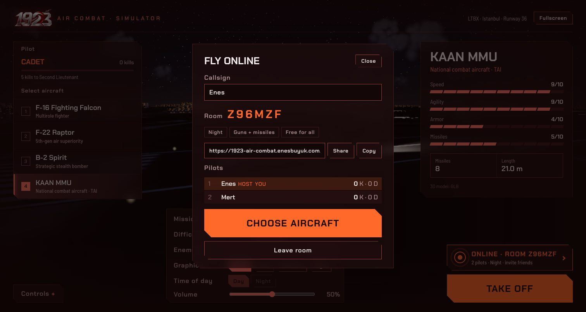
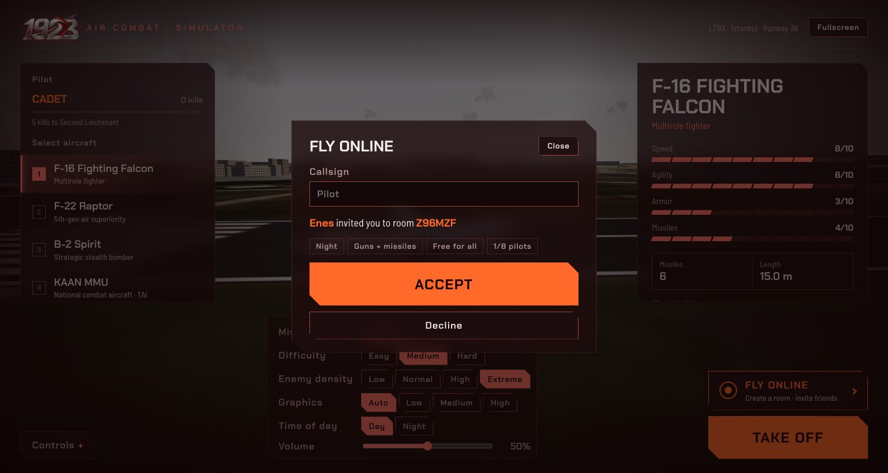
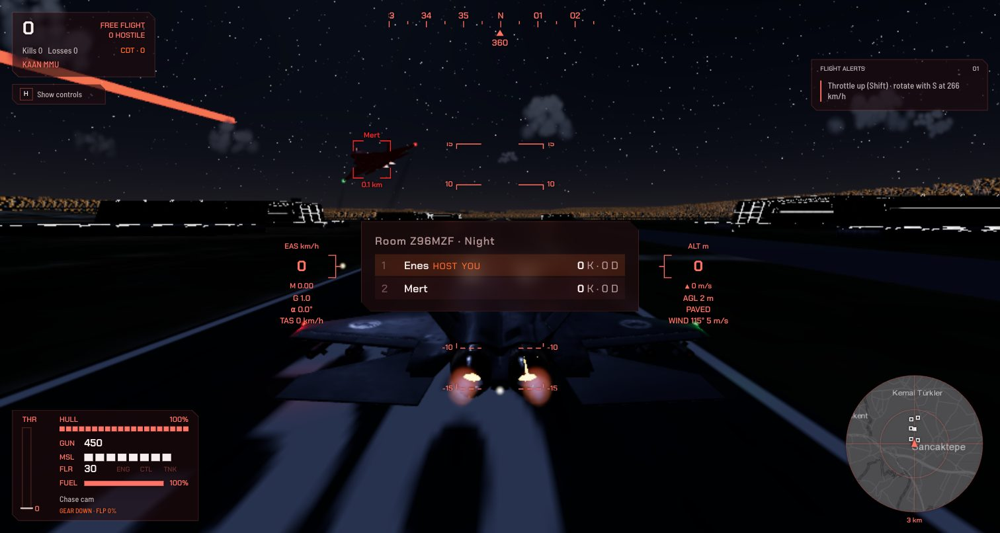

<div align="center">


# 1923 Air Combat

[English](README.md) | **Türkçe**

**İstanbul semalarında tarayıcıda oynanan uçuş ve it dalaşı oyunu**

Türk Hava Üssü'nden (LTBX) kalk, düşman dalgalarını düşür ve piste sağ salim geri in. Ya da arkadaşlarına bir oda linki gönder ve online olarak birbirinizle it dalaşına girin.

[](https://1923-air-combat.enesbuyuk.com)

[](LICENSE)


[](https://github.com/enesbuyuk/1923-air-combat)

**[Tarayıcıda oyna →](https://1923-air-combat.enesbuyuk.com)** · [Hata bildir](https://github.com/enesbuyuk/1923-air-combat/issues) · [Özellik iste](https://github.com/enesbuyuk/1923-air-combat/issues)

</div>

---

## İçindekiler

- [Ekran Görüntüleri](#ekran-görüntüleri)
- [Özellikler](#özellikler)
- [Uçaklar](#uçaklar)
- [Hızlı Başlangıç](#hızlı-başlangıç)
- [Kontroller](#kontroller)
- [Oyun Modları](#oyun-modlari)
- [Online Oyun](#online-oyun)
- [Hayatta Kalma İpuçları](#hayatta-kalma)
- [İniş Rehberi](#inis-rehberi)
- [3D Modeller](#3d-modeller)
- [Şehir](#şehir)
- [Proje Yapısı](#proje-yapısı)
- [Emeği Geçenler ve Lisanslar](#emeği-geçenler-ve-lisanslar)
- [Lisans](#lisans)

## Ekran Görüntüleri

Tam boyutunu görmek için görsele tıkla.

| Uçak seçimi | İstanbul üzerinde KAAN |
|:---:|:---:|
| [](docs/screenshots/aircraft-selection.jpg) | [](docs/screenshots/kaan-flight.jpg) |

| Davet linkiyle online oda | Arkadaştan gelen davet |
|:---:|:---:|
| [](docs/screenshots/online-room.jpg) | [](docs/screenshots/online-invite.jpg) |

<p align="center">
  <a href="docs/screenshots/online-night.jpg"></a>
  <br /><b>Gece odası: diğer pilot ateş açıyor</b>
</p>

| Escort modunda F-22 tırmanışı | Kokpit ve uçuş göstergeleri |
|:---:|:---:|
| [](docs/screenshots/f22-takeoff.jpg) | [](docs/screenshots/cockpit-hud.jpg) |

Gerçekçilik incelemesi ve öncelikli geliştirmeler: [Simülatör değerlendirmesi](docs/simulator-review.tr.md).

## Özellikler

- **Rust → WebAssembly oyun çekirdeği:** uçuş fiziği, kalkış/iniş, stall, bot yapay zekâsı, top mermisi, güdümlü füze ve kilitlenme, flare, çarpışma, dalga sistemi ve görevler. Dış bağımlılık yok, ~130 KB.
- **Uçuş fiziği:** hücum açısı ve yan kayması olan gerçek bir hız vektörü; taşıma ve sürükleme ISA hava yoğunluğu ve hızın karesiyle ölçeklenir, dönüşler hız (corner speed) ve uçağa özgü G limitiyle sınırlanır, sert çekişler indüklenmiş sürüklemeyle enerji kaybettirir. Mach 1 civarında transonik sürükleme artışı, irtifayla azalan itki, motor gecikmesi, yer etkisi, hamleli rüzgar ve alçak irtifa türbülansı.
- **Altı serbestlik dereceli katı cisim:** aerodinamik momentler (statik kararlılık, yunuslama / yatış / sapma sönümü, dihedral, kumanda yüzeyleri, stall kırılması, kanat düşmesi ve otorotasyon) ve eylemsizlik momentlerinin jiroskopik eşleşmesi (Euler denklemleri) gövdeyi döndürür. Hücum açısı / G sınırlayıcılı, otomatik trimli, koordineli dönüş yapan ve uçuş yolu etrafında yatan fly-by-wire uçuş kontrol bilgisayarı, hız sınırlı kumanda yüzeylerini stall olmamış gövde modelinin dinamik ters çevrimiyle sürer; yavaş ya da stall olmuş uçak kumanda otoritesini kendiliğinden kaybeder. Her şey 120 Hz dördüncü derece Runge-Kutta ile ilerler.
- **Yakıt ve ağırlık:** afterburner'da yakıt tüketimi hızla artar; dolu depo uçağı ağırlaştırır (daha yüksek stall hızı, daha yavaş tırmanış), boş depo motoru durdurur.
- **Enerji ve limitler:** kontroller yüksek hızda sertleşir; uçak en iyi azami hızda değil, corner speed civarında döner ve yatar. Sert çekerken yatış daha yavaştır. Rudder'lı stall'da stick geride tutulursa uçak spine girer (çıkmak için stick ileri ve ters rudder); yapısal hız sınırını aşan dalış gövdeye hasar verir (OVERSPEED).
- **Gerçek performans zarfı:** itki/ağırlık oranı gerçek uçaklara yakın (F-16 ~1.1, B-2 ~0.4); itki irtifayla düşer ve tropopozun üstünde daha hızlı düşer (her uçağın bir servis tavanı vardır); afterburner itkisi Mach ile artar, afterburner yakılınca yakıt tüketimi sıçrar. Top mermileri sürüklenmeyle yavaşlar ve saçılır; füzeler beş saniye yanar, en yakın geçişte patlar ve ıska mesafesi arttıkça daha az hasar verir; modern arayıcılar flare'lerin çoğunu ayırt eder; havada çarpışan iki uçak da kaybolur.
- **Yalnızca simülatör:** bütün görevlerde aynı sabit kurallar geçerlidir: top nişan yardımı ve fazladan büyütülmüş isabet alanı yoktur; uçağa özgü mühimmat kullanılır (F-16: 511 mermi; oyuncu ve bot B-2’lerde top ve havadan havaya füze yoktur); iniş limitleri sıkıdır (6 m/s alçalma, yaklaşık 20° yatış ve lastik için yer hızı sınırı); görev alanı sınırında dönüş pilotun sorumluluğundadır (30 s içinde dönülmezse uçak kaybedilir); hangar ikmali 90 s sürer. Oyuncu ve düşman füzeleri aynı harp başlığı hasarını kullanır. Gerçekçilik seçeneği kaldırılmıştır.
- **Manuel iniş takımı ve flap:** `G` takımı açar/kapatır; `Z` flapları kapalı / kalkış / iniş arasında değiştirir. Açılma zaman alır; takım sürüklemeyi, flap kaldırma ve sürüklemeyi artırır ve stall hızını düşürür. Fazla hız hasar ve sıkışma oluşturabilir. Kapalı, yarım açık veya ağır hasarlı takımla normal teker inişi yapılamaz.
- **Arazi ve yüzeyler:** görsel zemin ve fizik aynı yükseklik alanını kullanır. Havalimanı düz kalır; tepeler AGL’yi, yer etkisini, teması ve sensör maskelemesini değiştirir. Asfalt ve toprak farklı yuvarlanma direnci/frenleme üretir; su teması uçağı kaybettirir. Yükselti ve kıyı çizgisi temsili/prosedüreldir, ölçülmüş İstanbul DEM verisi değildir.
- **Sensörler:** radar ve görsel algılama menzil, tarama konisi ve arazi/bina görüş hattıyla sınırlıdır. İzler saniyede dört kez yenilenir. Kaybolan hedef son bilinen konumunda MEM olarak 1,5 saniye tutulur, sonra silinir; HUD engel arkasındaki hedefin canlı konumunu göstermez.
- **Sistem hasarı:** isabetler gövde hasarının yanında motoru (daha az itki), uçuş kontrollerini (ağır pitch ve roll) ya da yakıt deposunu (sızıntı) vurabilir.
- **Yer ekibi:** havalimanındaki beş hangardan birine taksi yap, dur ve gazı rölantiye al; ekip 90 saniyede mühimmatı, yakıtı ve hasarı yeniler. Hangar dışında ikmal yok.
- **Botlarla ortak fizik ve yükler:** oyuncu ve botlar aynı yakıt tüketimini, mühimmat kapasitelerini, top atım hızını/saçılmasını, mermi hızını, silah hasarını, sistem hasarı olasılıklarını ve aşırı hız limitini kullanır. Zorluk gövde canını veya silah gücünü değiştirmez; pilot davranışını (kararlar, nişan, kilitlenme süresi, füze menzili ve aralığı) ve dalga büyüklüğünü değiştirir. Botlar yakıt azaldığında veya silahları tükendiğinde üsse döner, yaklaşmada takım/flap açar; güvenli teker koyuş tamamlanan sortiyi görevden çıkarır.
- **Gerçek enerjili füzeler:** orantılı seyrüsefer (PN) güdümü, birkaç saniye yanıp sonra süzülen roket motoru, hava yoğunluğuyla artan sürükleme, yavaşlayınca etkisini kaybeden kanatçıklar ve seeker gimbal limiti. Geç ve yavaşlamış bir füze dönüşle atlatılabilir; uzaktaki kaçan bir hedefe yetişemez.
- **Karşı tedbir ve ikaz:** avcılar ilk dalgadan itibaren kendi füze yüklerini taşır. Havadan havaya IR arayıcılar pasiftir, RWR’yi tetiklemez; radar güdümlü SAM kilitleri tetikler. Füze ikaz sistemi 8 km içinde açık görüş hattı ister. Flare IR füzelerini aldatabilir; radar güdümlü SAM’lerden manevra veya arazi/bina maskelemesiyle kaçılır.
- **Görevler:** sonsuz *Waves*, *Strike* (her hedef bölgesindeki SAM sahalarını yok et; radar ufkunun üstündeki her şeye ateş ederler, alçak uç), *Escort* (dost bir B-2'yi rotası boyunca koru) ve *Free* (düşman yok, sadece uç).
- **Online odalar:** bir oda kur (gündüz veya gece, yalnız top veya top + füze), davet linkini paylaş; en fazla 8 arkadaş canlı skor tablosuyla herkes herkese karşı uçar. Bkz. [Online Oyun](#online-oyun).
- **Kill cam:** düşürüldükten sonra son saniyeler ağır çekimde tekrar oynatılır.
- **Gündüz ve gece:** *Time of day* ayarı (menü veya duraklatma ekranı) yıldızlı, ay ışıklı bir geceye geçer: koyu pus, şehirde yanan pencereler ve parlayan pist kenar ışıkları; her uçakta kırmızı/yeşil seyir ışıkları, beyaz kuyruk ışığı, çift çakan strob ve kırmızı beacon, iniş takımı açıkken de oyuncunun önündeki pisti aydınlatan iniş farı var. Art yakıcılar ve patlamalar öne çıkar. Uçuş sırasında da değiştirilebilir.
- **Sabit adımlı simülasyon:** çekirdek kare hızından bağımsız olarak her adımda 1/60 sn ilerler, görüntü adımlar arasında interpolasyon yapar.
- **Gamepad ve dokunmatik:** standart eşlemeli gamepad'ler doğrudan çalışır; dokunmatik ekranlarda ekran üstü stick, gaz ve butonlar çıkar.
- **Gerçek dünya:** Esri World Imagery uydu karoları (3 zoom seviyesi); pistler, apronlar ve helipadler OpenStreetMap geometrisinden (18/36 ana pist 1415 m, 04/22 çapraz pist).
- **Sonsuz prosedürel şehir:** uçtukça etrafında açılan, her oyunda farklı İstanbul silueti.
- **Kilitlenmeli füzeler ve nişan yardımsız top atışı**
- **Pilot kariyeri:** her düşürülen uçak tarayıcıda saklanan toplam kill sayısına eklenir; Cadet (0) rütbesinden başlayıp Second Lieutenant (5), First Lieutenant (15), Captain (30), Major (60), Lieutenant Colonel (100), Colonel (175), Brigadier General (275), Major General (400) ve Lieutenant General (600) üzerinden General (900) rütbesine terfi edersin.
- **Sentezlenmiş ses:** motor, silah ve patlama sesleri WebAudio ile anlık üretiliyor. Tek kayıtlı ses "Pull up, pull up" alçak irtifa sesli uyarısı (`web/audio/pull_up.mp3`).
- **Kurulum yok:** tarayıcıda açılıyor.

## Uçaklar

| Uçak | Karakter |
|---|---|
| **F-16 Fighting Falcon** | Dengeli, çevik |
| **F-22 Raptor** | En hızlı ve en çevik |
| **B-2 Spirit** | Stratejik bombardıman uçağı; top ve havadan havaya füze yok (bombalama henüz uygulanmadı) |
| **KAAN MMU** | Hızlı, çevik, 8 füze |

Düşmanlar aynı modellerin kırmızı tonlu versiyonlarıdır. 3. dalgadan itibaren her dalgada bir **B-2** bulunur (500 puan).

## Hızlı Başlangıç

Oynamak için kurulum gerekmez: **[1923-air-combat.enesbuyuk.com](https://1923-air-combat.enesbuyuk.com)** adresini aç.

Yerelde çalıştırmak için:

**Gereksinimler:** [Rust](https://rustup.rs) (`rustup`), Python 3

```bash
git clone https://github.com/enesbuyuk/1923-air-combat.git
cd 1923-air-combat
./build.sh serve        # wasm'ı derler, http://localhost:8080 adresini açar
```

- Sadece derlemek için: `./build.sh`
- Online odalarla (worker, `wrangler dev` üzerinden): `./build.sh online`, bkz. [Online Oyun](#online-oyun)
- 8080 doluysa betik bir sonraki boş portu bulur; elle seçmek için: `PORT=3000 ./build.sh serve`

> [!NOTE]
> WASM `fetch` ile yüklendiği için `index.html` dosyasını `file://` üzerinden açmak çalışmaz; bir HTTP sunucusu gerekir.

## Kontroller

| Tuş | İşlev |
|---|---|
| `S` / `↓` | Burun yukarı (kalkışta Vr hızında bas) |
| `W` / `↑` | Burun aşağı |
| `A` `D` / `←` `→` | Yatış (roll) |
| `Q` `E` | Dümen (yerde burun tekerleği) |
| `Shift` / `R` | Gaz artır |
| Sol `Ctrl` / `F` | Gaz azalt (tam ekranda `Ctrl+W` sekmeyi kapatmaz) |
| `Space` / sol tık | Top namlu doğrultusunda ateşler; saçılma ve mermi düşüşü vardır, nişan yardımı yoktur |
| `X` / sağ tık | Füze, kilitlenmek için hedefi ~0.6 sn boyunca 30° koni içinde tut |
| `C` | Flare (basılı tutunca atmaya devam eder) |
| `B` | Yerde tekerlek freni, havada hava freni |
| `G` | İniş takımını aç / kapat (yerde kapatma engellenir) |
| `Z` | Flap: kapalı / kalkış (%50) / iniş (%100) |
| `V` | Kamera (kokpit / takip) |
| `H` | Kontrol listesini göster / gizle |
| Fare tekerleği | Takip kamerası yakınlaştırma |
| Orta tuşla sürükleme | Etrafa bakma (kokpit) / uçağın çevresinde dönme (takip) |
| `I` | Pitch eksenini ters çevir |
| `M` | Sesi aç / kapat |
| `N` | Uyarı seslerini aç / kapat (RWR, füze, pull up) |
| `Esc` | Duraklat |
| `Tab` (basılı) | Online odada skor tablosu |

**Gamepad** (standart eşleme): sol stick pitch ve roll, sağ stick dümen, `RT` / `LT` gaz artır / azalt, `A` top, `B` füze, `X` veya `RB` flare, `LB` fren, D-pad yukarı takım, D-pad aşağı flap, `Y` kamera, `Start` duraklat.

**Dokunmatik ekranlar:** uçarken ekran üstü stick (sol alt), gaz kaydırıcısı ve silah butonları (sağ alt) görünür.

<a id="oyun-modlari"></a>

## Oyun Modları

Görevi menüden veya duraklatma ekranından seç. Bütün görevler simülatör kurallarını kullanır.

| Mod | Hedef |
|---|---|
| **Waves** | Uçağa özgü yakıt ve mühimmatla sonsuz düşman dalgaları. Sonraki dalgalar sayı ve pilot becerisini artırır. |
| **Strike** | Hedef bölgedeki tüm SAM sahalarını top veya füzeyle yok et (uçaklar gibi kilitlenirler). Her saha 7 km içinde, yerden yaklaşık 120 m üstündeki uçağı açık görüş hattında algılar; arazi ve binalar radarını perdeleyebilir. Temizlenen bölge bonus kazandırır, ardından daha büyük bir bölge gelir. Küçük düşman dalgaları koruma yapar. |
| **Escort** | Dost bir B-2 (HUD ve radarda mavi) üs çevresinde bir tur uçar. Düşman avcıları onu hedefler; sekiz ayağı tamamlatırsan bonus kazanırsın. |
| **Free** | Düşman, SAM sahası veya hedef yok. Şehrin üstünde serbestçe uç. |

## Online Oyun

Arkadaşlarınla birbirinize karşı uç (herkes herkese karşı).

1. Menünün sağ üstündeki **Online**: bir çağrı adı gir, odanın **gün saatini** (gündüz / gece) ve **silahlarını** (top + füze / yalnız top) seç, **Create room**'a bas.
2. Davet linkini (`…/?room=ABC123`) **Share** veya **Copy** ile arkadaşlarına gönder.
3. Linki açan, oda ayarlarıyla birlikte daveti görür; **Accept** ile odaya katılır.
4. Herkes uçağını seçip kalkar. Her pilotun 36 pistinde kendi yeri vardır; birbirinizi düşürün, yeniden doğma her zamanki gibi çalışır. Skor tablosu için `Tab`'ı basılı tut.

Bir odada en fazla 8 pilot olur. Odayı kuranın ayarları herkes için geçerlidir (odadayken görev, zorluk, yoğunluk ve gün saati ayarları kilitlenir) ve herkes aynı havada uçar. Duraklatmak odayı durdurmaz: uçağın kumandasız uçmaya devam eder. Son pilot ayrıldıktan bir gün sonra oda silinir.

Nasıl çalışır: worker, bir odanın pilotları arasındaki mesajları bir Durable Object üzerinden aktarır (`worker/room.js`); hiçbir şey simüle etmez. Her istemci kendi uçağını uçurur, diğerlerini kendi çekirdeğindeki bot yuvalarına yansıtır ve 20 Hz durum güncellemeleri arasında ileri kestirir. Top isabetlerine ateş edenin istemcisi karar verir ve vurulana gönderir; füzeyi hedefin istemcisi uçurur, böylece flare ve kaçış gerçek füzeye karşı işler. Her pilot kendi düşüşünü bildirir; düşüş, ona son hasar vereni yazılır.

Online oyun worker gerektirir, `./build.sh serve` onu çalıştırmaz. Yerelde `./build.sh online` kullan (Node.js ve `.env` içinde `R2_BUCKET` gerekir): oyunu oda sunucusuyla birlikte `wrangler dev` üzerinden açar, uçak modellerini ilk seferde yerel R2'ye kopyalar. Başka bilgisayarlardaki arkadaşların için oyunun yayında olması gerekir (`tools/deploy.sh`).

<a id="hayatta-kalma"></a>

## Hayatta Kalma İpuçları

- Radar halkası ve yükselen cıvıltı bir düşman radarının sana kilitlendiğini gösterir; hızlı ötüş ve radardaki kırmızı çizgi havada bir füze olduğunu gösterir.
- Füzeye karşı: flare at (`C`), gazı geri çek ve füzenin yolunu keserek sert dön. Motoru bitince füze enerji kaybeder, geç ve yavaş bir füze dönüşle atlatılabilir.
- Yakıt göstergesini izle: `BINGO FUEL` eve dönme zamanı demek. İn, bir hangara taksi yap, `B` ile dur ve rölantide bekle; yer ekibi yakıtı, mühimmatı, flare'leri, gövdeyi ve sistemleri yeniler.

<a id="inis-rehberi"></a>

## İniş Rehberi

1. `Ctrl` ile gazı kes, `B` ile hava frenini aç.
2. ~300–350 km/sa hıza düş ve sığ bir yaklaşma kur. Motorun tepki gecikmesini hesaba kat; flare’e zamanında başla ve teker koyarken alçalma hızını 3 m/s altında tut.
3. Son 25 m'de yer etkisi alçalmayı yumuşatır; `S` ile burnu hafifçe kaldır (flare).
4. `G` ile takımı 155 m/s eşdeğer hava hızının altında aç; tam açılması için 3 saniye bekle. `Z` ile flap seç; tam iniş flapını 105 m/s eşdeğer hava hızının altında aç ve 2 saniyelik hareket süresini hesaba kat. Teker koymadan takımın DOWN ve sağlam olduğunu doğrula. Kalkışta pozitif tırmanış kurduktan sonra takımı ve flapları topla. Pistte rölantide spoylerler taşımayı keser.

| Teker koyma limiti | Değer |
|---|---|
| Alçalma hızı | < 6 m/s; 3 m/s üzeri hasar verir, hasarlı bir uçağı yok edebilir |
| Yatış | < ~20° (burun açısı ile yatış birlikte değerlendirilir) |
| Burun | < ~20° aşağı |
| Yer hızı | < 2 × nominal 1 G stall hızı (F-16: 110 m/s, 396 km/sa) |

Daha sert inişler veya dik dalışlar patlamayla biter. İki pistin yaklaşma koridorlarındaki binalar 1:40 eğimli engel yüzeyinin altında tutulur; normal bir süzülüş bunların üzerinden geçer.

## 3D Modeller

Dört uçağın GLB modelleri `web/models/` altında. Bir dosya eksikse oyun o uçak için kendi prosedürel modelini üretir. Değiştirmek için aynı isimle bir dosya koyman yeterli:

```
web/models/f16.glb
web/models/f22.glb
web/models/b2.glb
web/models/kaan.glb
```

- Modelde `landingOn`/`landingOff` (veya `gearDown`/`gearUp`) isimli parçalar varsa iniş takımları otomatik açılıp kapanır ve tekerlekler piste oturur.
- Ölçek otomatiktir: model uçağın gerçek uzunluğuna göre normalize edilir (örn. F-16 → 15 m). Burun `-Z` yönüne bakmalı.
- Yanlış yöne bakan bir model `web/models/models.json` ile düzeltilir:

```json
{
  "f16": { "rotation": [0, 180, 0], "scale": 1 },
  "kaan": { "rotation": [0, 90, 0], "lengthAxis": "z" }
}
```

Kullandığın modellerin lisanslarına dikkat et (CC-BY atıf gerektirir).

## Şehir

Havalimanının çevresinde (~6 km) **gerçek binalar** var: OpenStreetMap'ten çekilen bina tabanları kat/yükseklik verilerine göre yükseltilir (`web/js/buildings.js`, veri `web/data/buildings.json` içinde). Veriyi yenilemek veya yarıçapı değiştirmek için:

```bash
uv run python3 tools/fetch_osm_buildings.py 6000   # metre cinsinden yarıçap
```

Bina verisi © [OpenStreetMap](https://www.openstreetmap.org/copyright) katkıcıları, ODbL.

Bu alanın ötesinde rastgele bir şehir devam eder. Binalar ve ağaçlar Kenney'nin [City Kit (Commercial)](https://kenney.nl/assets/city-kit-commercial) ve [City Kit (Suburban)](https://kenney.nl/assets/city-kit-suburban) paketlerinden (CC0) geliyor, `web/models/city/` altında.

`web/js/city.js` dünyayı 500 m'lik parçalara böler. Oyuncu uçtukça yakındaki parçalar tohumlu rastgelelikle doldurulur:

- **Şehir merkezi** → ofisler ve gökdelenler
- **Banliyö** → evler
- **Kırsal** → ağaçlar

Yakın parçalar detaylı, uzaktakiler düşük detaylı modellerle çizilir. Her açılışta yeni bir tohum → yeni bir şehir; aynı oturumda bir bölgeye geri dönünce aynı binalar görünür.

## Proje Yapısı

```
wasm/src/lib.rs                WASM dışa aktarımları (Rust → wasm32-unknown-unknown)
wasm/src/config.rs             uçak performansı, zorluk, fizik ve pist sabitleri
wasm/src/layout.rs             JS ile paylaşılan çıktı tampon düzeni
wasm/src/math.rs               vektörler, kuaterniyonlar, RNG
wasm/src/entities.rs           ortak gövde durumu, oyuncu, bot, mermi, füze, flare, SAM sahası verileri
wasm/src/game/aero.rs          oyuncu ve botların ortak uçuş modeli (taşıma, sürükleme, itki, yakıt, kütle, 6DOF katı cisim, fly-by-wire)
wasm/src/game/flight.rs        oyuncu: yer koşusu, teker koyma, yer ekibi, silahlar, flare, kilitlenme
wasm/src/game/bots.rs          düşman dalgaları, bot taktikleri ve otopilot
wasm/src/game/projectiles.rs   top mermileri, füze güdümü ve enerjisi, flare
wasm/src/game/missions.rs      oyun modları: waves, strike (SAM sahaları), escort, free
wasm/src/game/                 ayrıca oyun durumu (mod.rs), atmosfer/hava (air.rs), testler (cargo test)
web/index.html                 menü + katmanlar
web/js/main.js                 açılış, oyun durumu, oyun döngüsü, olay işleme
web/js/sim.js                  wasm yükleme + tamponları isimli alanlara çözme
web/js/layout.js               layout.rs'nin JS karşılığı
web/js/aircraft.js             uçak listesi (isim, uzunluk, kokpit göz noktası, egzozlar, füzeler, G limiti)
web/js/actors.js               sahnedeki oyuncu/bot uçakları: alevler, iniş takımı
web/js/camera.js               menü, kokpit, takip, enkaz ve kill cam kameraları
web/js/airflow.js              hava akışı çizgileri ve sarsıntı seviyesi (hamle, türbülans, yüksek hücum açısı)
web/js/vortex.js               kanat ucu girdap ipleri (sirkülasyon, alçalma, sarılma, yer etkisi, çekirdek büyümesi)
web/js/vapor.js                sert çekişte kanat üstü buharı, ses hızı civarında buhar konisi
web/js/atmosphere.js           gündüz ve gece gökyüzü, gökyüzünden ortam aydınlatması, irtifaya bağlı pus
web/js/clouds.js               kamera çevresinde cumulus bulutları, bulut içinde beyazlama
web/js/post.js                 son işleme: ısı dalgalanması, bulut beyazlaması, bloom, ton eşleme
web/js/flyby.js                yakındaki uçakların sesi (Doppler, yön) ve sonic boom
web/js/wing.js                 her modelin mesh'inden ölçülen kanat ucu ve kök veter
web/js/input.js                klavye / fare / gamepad kontrolleri
web/js/touch.js                ekran üstü dokunmatik kontroller
web/js/replay.js               kill cam kaydı ve ağır çekim tekrar
web/js/ground.js               SAM sahası modelleri (strike modu)
web/js/gforce.js               G kararması / G-LOC efekti
web/js/menu.js                 uçak seçim menüsü
web/js/settings.js             görev / zorluk / düşman yoğunluğu ayarları
web/js/collision.js            bina çarpışma testleri
web/js/models.js               prosedürel uçak + GLB yükleyici
web/js/navlights.js            uçak seyir ışıkları, strob, beacon ve iniş farı (gece)
web/js/world.js                uydu zemini, pistler, gökyüzü
web/js/buildings.js            OSM'den gerçek binalar (havalimanı çevresi)
web/js/city.js                 akışlı prosedürel şehir (Kenney modelleri)
web/js/effects.js              izli mermiler, füzeler, flare, patlamalar, duman
web/js/hud.js                  HUD (pitch merdiveni, hız/irtifa, radar ve RWR, hedef kutuları, yakıt, sistemler, görev)
web/js/audio.js                sentezlenmiş sesler + pull up sesli uyarısı
web/audio/pull_up.mp3          "Pull up, pull up" ses kaydı
tools/fetch_osm_buildings.py   OSM bina tabanlarını oyun koordinatlarına çeviren yardımcı betik
build.sh                       derleme + yerel sunucu
```

### JS ↔ WASM arayüzü

```
init(aircraft, seed)   set_input(...)   set_mode(mode)   step(dt)
```

Durum doğrusal bellekten `Float32Array` olarak okunur: `player_ptr`, `bots_ptr`, `bullets_ptr`, `missiles_ptr`, `flares_ptr`, `ground_ptr`, `events_ptr`, `stats_ptr`. JS döngüsü `step`i her zaman sabit 1/60 sn adımla çağırır. Alan sırası `wasm/src/layout.rs` içinde tanımlı ve `web/js/layout.js` içinde aynısı var; ikisini birlikte değiştir.

## Emeği Geçenler ve Lisanslar

| Varlık | Kaynak | Lisans |
|---|---|---|
| F-16 modeli | ["F-16 Fighting Falcon - Fighter Jet - Free"](https://sketchfab.com/3d-models/f-16-fighting-falcon-fighter-jet-free-f0b00989e5634764848ef2c235c64db5), bohmerang | CC-BY-NC-SA-4.0 (ticari kullanım yok) |
| F-22 modeli | ["F-22 Raptor - Fighter Jet - Free"](https://sketchfab.com/bohmerang), bohmerang | CC-BY-NC-SA-4.0 (ticari kullanım yok) |
| KAAN modeli | "KAAN - Milli Muharip Uçak - KAAN 3D MODEL", [Özcan Özaltın](https://sketchfab.com/ozcan_36) | CC-BY-4.0 |
| B-2 modeli | "B-2 spirit", [hilos run](https://sketchfab.com/josue.santiagorm22) | CC-BY-4.0 |
| Hangar modeli | ["Rebel Hangar Version 1"](https://sketchfab.com/3d-models/rebel-hangar-version-1-2dfef17c8737459e95af621034acb00b), [MichaelEGA](https://sketchfab.com/MichaelEGA) | CC-BY-4.0 |
| Şehir modelleri | [Kenney](https://kenney.nl) City Kit | CC0 |
| Uydu görüntüsü | © Esri, Maxar, Earthstar Geographics | - |
| Pist verisi | © OpenStreetMap katkıcıları | ODbL |
| Mini harita karoları | © Esri, HERE, Garmin, © OpenStreetMap katkıcıları | - |

> [!IMPORTANT]
> F-16 ve F-22 modelleri ticari olmayan lisanslar altındadır; proje bu modellerle birlikte ticari amaçla dağıtılamaz.

## Lisans

Bu projenin kaynak kodu (Rust, JavaScript, HTML, CSS, Python ve shell betikleri) [MIT Lisansı](LICENSE) ile yayınlanmıştır.

Üçüncü taraf varlıklar (3D modeller, uydu görüntüleri ve harita verileri) MIT Lisansı kapsamında **değildir**; [Emeği Geçenler ve Lisanslar](#emeği-geçenler-ve-lisanslar) bölümünde listelenen kendi lisanslarına tabidir.

---

<div align="center">

Geliştiren: [Enes Buyuk](https://github.com/enesbuyuk) · [Canlı Demo](https://1923-air-combat.enesbuyuk.com) · [Kaynak Kod](https://github.com/enesbuyuk/1923-air-combat)

</div>
